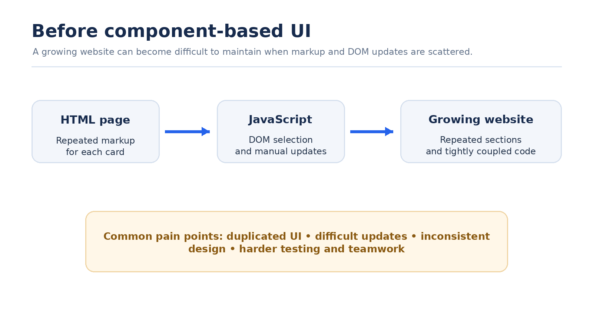
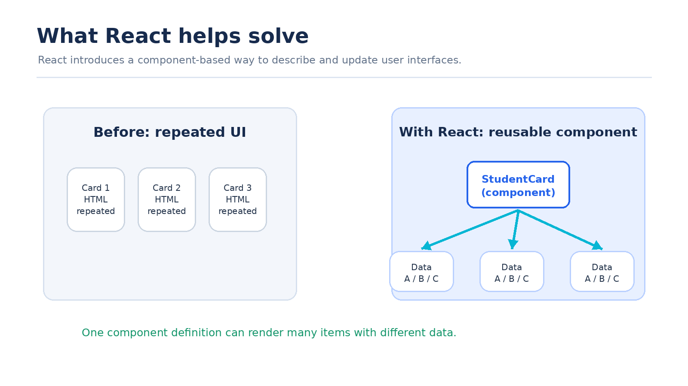
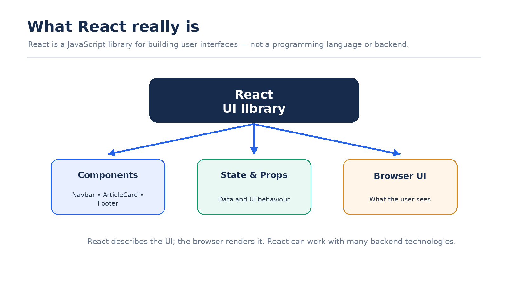
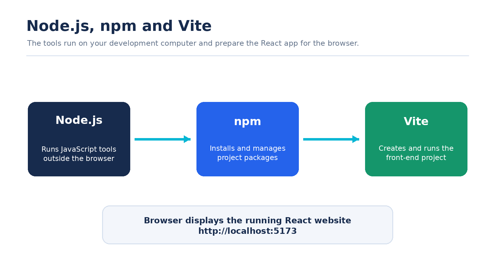
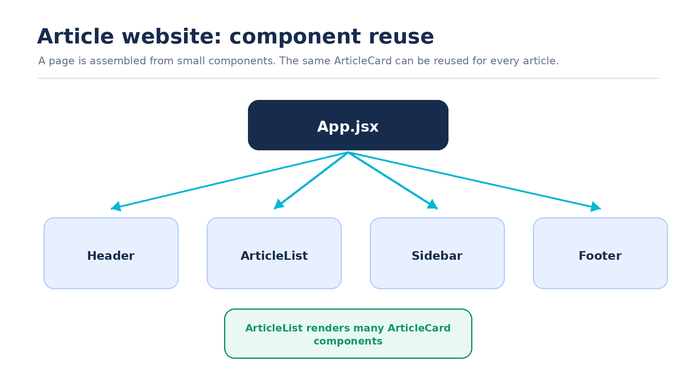

# React JS: From the Problems Before React to a Reusable Article Website

A beginner-friendly practical guide for students who already know **HTML, CSS, JavaScript, Python and MySQL**.

> **Learning outcome:** Understand why React is used, install Node.js and npm, create a React project with Vite, understand the project structure, and build an article website using reusable components.

## Table of contents

1. [Problems before React](#1-what-problems-did-developers-face-before-react)
2. [Why React was created](#2-why-was-react-created-and-what-problems-does-it-solve)
3. [What React really is](#3-what-is-react-really)
4. [Node.js and npm](#4-why-do-we-install-nodejs-and-use-npm)
5. [Why Vite](#5-why-choose-vite-to-create-a-react-project)
6. [Project structure](#6-react-project-structure-explained)
7. [Build an article website](#7-build-an-article-website-using-reusable-react-components)
8. [Practice tasks](#8-practice-tasks)
9. [Recap and references](#9-quick-recap)

---

## 1. What problems did developers face before React?

Before component-based libraries became common, developers built pages using HTML, CSS and JavaScript. This approach is still valid, especially for simple and mostly static websites. But as an application grows and its interface changes frequently, maintenance can become difficult.

### Common challenges

1. **Repeated HTML:** Similar product cards, article cards, menus or profile sections may be copied many times.
2. **Manual DOM updates:** JavaScript may need to find elements and change text, attributes, classes or visibility. Keeping many related UI parts consistent can become difficult.
3. **Difficult maintenance:** A design change may need to be repeated in multiple places when markup has been copied.
4. **Scattered UI logic:** Event handlers, data updates and DOM manipulation can become mixed together.
5. **Team collaboration:** A large page with tightly connected code can be harder to understand, test and maintain.



### Example: manually updating the DOM

```html
<h1 id="message">Hello</h1>
<button onclick="changeMessage()">Change message</button>

<script>
  function changeMessage() {
    document.getElementById("message").textContent =
      "Welcome to the website!";
  }
</script>
```

This is valid JavaScript. The problem is not that this code is wrong. The challenge appears when many UI elements and data relationships must be managed across a large application.

---

## 2. Why was React created, and what problems does it solve?

Facebook (now Meta) developed React to help manage complex, frequently changing user interfaces. React was open-sourced in 2013.

React encourages developers to split an interface into **small, reusable components** and describe what the UI should look like for the current data.

### How React helps

| Challenge | React approach |
|---|---|
| Repeated UI markup | Reusable components |
| UI changes when data changes | State-driven rendering |
| Data passed between components | Props |
| Large page is hard to organize | Component-based architecture |
| UI logic is difficult to maintain | Smaller components with focused responsibilities |



### Example: reusable article card

```jsx
function ArticleCard({ title, author }) {
  return (
    <article className="article-card">
      <h2>{title}</h2>
      <p>Written by {author}</p>
    </article>
  );
}

export default ArticleCard;
```

Use the same component with different data:

```jsx
<ArticleCard title="Introduction to Python" author="Arun" />
<ArticleCard title="Learning React" author="Priya" />
<ArticleCard title="Understanding MySQL" author="Kumar" />
```

One component definition is reused with different props.

**Important:** React does not replace HTML, CSS, JavaScript, a backend or a database. It focuses on building and updating the user interface.

---

## 3. What is React really?

**React is an open-source JavaScript library for building user interfaces.** It is mainly used for the front end of web applications.

- **JavaScript:** the programming language.
- **React:** a library for building user interfaces with components.
- **HTML:** provides document structure.
- **CSS:** controls appearance and layout.
- **Backend:** handles server-side logic and business rules.
- **Database:** stores application data.



### Important React concepts

| Concept | Meaning | Example |
|---|---|---|
| Component | Reusable UI building block | Navbar, ArticleCard |
| JSX | HTML-like syntax used in JavaScript | `<h1>Hello</h1>` |
| Props | Data passed from parent to child | Article title |
| State | Data that can change over time | Like count |
| Event | Interaction handled by the app | Button click |
| Hook | Function that lets a component use React features | `useState` |

### React and the browser

React components describe the UI. React DOM connects React to the browser DOM and updates the rendered interface as needed.

A typical full-stack application can look like this:

```text
User
  |
  v
React Frontend
  |
  | HTTP request / JSON response
  v
Backend API (Python / Node.js / Java)
  |
  v
Database (MySQL)
```

**React does not normally connect directly to MySQL from the browser.** The frontend communicates with a backend API, and the backend communicates with the database.

---

## 4. Why do we install Node.js and use npm?

A common question is: **If React runs in the browser, why do we need Node.js and npm?**

The key is to understand the difference between development tools and the browser runtime.

### What is Node.js?

Node.js is a JavaScript runtime that allows JavaScript programs to run outside the browser. During React development, tools such as Vite and other development utilities run using Node.js.

### What is npm?

npm is the package manager commonly installed with Node.js.

We use npm to:

- Install React and other packages.
- Install development tools.
- Manage project dependencies.
- Run scripts such as `npm run dev`.
- Keep track of installed package versions through package files.

**You normally do not download npm separately.** Installing Node.js using the official installer also installs npm.



### Download and install Node.js on Windows

1. Open the official website: [https://nodejs.org/](https://nodejs.org/)
2. Download the recommended **LTS** release.
3. For a typical Windows computer, choose the Windows Installer (`.msi`) matching your system architecture, usually x64.
4. Open the installer and follow the setup wizard.
5. Keep the option to add Node.js to PATH enabled.
6. Finish installation.
7. Close and reopen PowerShell or the VS Code terminal.

Verify the installation:

```powershell
node -v
npm -v
```

Both commands should print version numbers.

### Windows PowerShell: if npm is blocked

If PowerShell says `npm.ps1` cannot be loaded because script execution is disabled, Node.js may still be installed correctly.

Use the Windows command wrapper:

```powershell
npm.cmd -v
```

You can also use `npm.cmd` for project commands:

```powershell
npm.cmd create vite@latest my-react-app
```

If you are allowed to change the execution policy on your own computer, this command enables locally created scripts and signed remote scripts for the current user:

```powershell
Set-ExecutionPolicy -Scope CurrentUser -ExecutionPolicy RemoteSigned
```

Only change this setting if you understand and are permitted to do so, especially on an organization-managed computer.

---

## 5. Why choose Vite to create a React project?

There are different ways to set up a React project. For a new learning project, **Vite is a popular, lightweight development tool**.

### What is Vite?

Vite is a front-end build tool. It provides a development server and builds production-ready assets.

### Why use Vite?

- Quick project setup.
- Fast development server.
- Hot Module Replacement (HMR), which updates the browser during development.
- Simple project configuration.
- Supports React through its official templates.
- Builds optimized files for deployment.

### Create a React project using Vite

**Step 1 — Create the project**

```bash
npm create vite@latest my-react-app
```

If PowerShell blocks `npm`, use:

```powershell
npm.cmd create vite@latest my-react-app
```

**Step 2 — Choose the options**

```text
Project name: my-react-app
Framework: React
Variant: JavaScript
```

**Step 3 — Enter the project folder**

```bash
cd my-react-app
```

**Step 4 — Install dependencies**

```bash
npm install
```

**Step 5 — Start the development server**

```bash
npm run dev
```

**Step 6 — Open the URL**

Vite normally displays a local address such as:

```text
http://localhost:5173/
```

Open it in your browser.

| Command | Purpose |
|---|---|
| `npm create vite@latest` | Runs the Vite project creation tool |
| `cd my-react-app` | Moves into the project directory |
| `npm install` | Installs packages listed in the project |
| `npm run dev` | Starts the development server |

---

## 6. React project structure explained

A new Vite React project contains several files and folders. The exact structure may vary depending on the selected template and Vite version.

### Typical project structure

```text
my-react-app/
│
├── node_modules/
├── public/
│   └── vite.svg
│
├── src/
│   ├── assets/
│   ├── App.jsx
│   ├── App.css
│   ├── index.css
│   └── main.jsx
│
├── .gitignore
├── eslint.config.js
├── index.html
├── package.json
├── package-lock.json
└── vite.config.js
```

### Detailed explanation

#### 1. `node_modules/`

- Contains packages installed by npm.
- Includes React, React DOM, Vite and other dependencies.
- Usually should not be committed to GitHub.
- Can be recreated using `npm install`.

#### 2. `public/`

- Stores static files that should be served as-is.
- Examples: favicon and downloadable files.
- Files placed here are not imported as JavaScript modules.

#### 3. `src/`

The main source-code folder where most React development happens.

#### 4. `src/assets/`

Stores assets imported by components, such as logos, images, icons and fonts. Vite processes imported assets during the build.

#### 5. `App.jsx`

- Contains the main App component.
- Other components are often imported and arranged here.
- It is commonly the starting point for building the application's UI.

```jsx
function App() {
  return (
    <div>
      <h1>My React Website</h1>
    </div>
  );
}

export default App;
```

#### 6. `App.css`

Contains styles for the App component and related UI. You can also create separate CSS files for individual components.

#### 7. `index.css`

Contains global CSS rules, such as body styles, font family, resets and default colors.

#### 8. `main.jsx`

- Entry point of the React application.
- Imports React, React DOM and the App component.
- Renders the App component into the HTML element with the `root` ID.

```jsx
import React from "react";
import ReactDOM from "react-dom/client";
import App from "./App.jsx";
import "./index.css";

ReactDOM.createRoot(
  document.getElementById("root")
).render(
  <React.StrictMode>
    <App />
  </React.StrictMode>
);
```

#### 9. `index.html`

The main HTML document used by Vite. It contains the root element where React renders the application and loads the JavaScript entry point.

```html
<!doctype html>
<html lang="en">
  <head>
    <meta charset="UTF-8" />
    <meta name="viewport" content="width=device-width, initial-scale=1.0" />
    <title>My React App</title>
  </head>
  <body>
    <div id="root"></div>
    <script type="module" src="/src/main.jsx"></script>
  </body>
</html>
```

#### 10. `package.json`

- Stores project metadata.
- Lists dependencies and development dependencies.
- Defines scripts such as `dev`, `build` and `preview`.

Example (version numbers are shortened here for explanation):

```json
{
  "scripts": {
    "dev": "vite",
    "build": "vite build",
    "preview": "vite preview"
  },
  "dependencies": {
    "react": "...",
    "react-dom": "..."
  },
  "devDependencies": {
    "vite": "..."
  }
}
```

#### 11. `package-lock.json`

Records the exact dependency tree installed by npm and helps reproduce the same dependency versions. Usually commit this file to GitHub.

#### 12. `vite.config.js`

Contains Vite configuration. The React template uses a React plugin. It can be customized when the project needs additional build configuration.

#### 13. `eslint.config.js`

Contains ESLint configuration. ESLint helps detect potential code-quality issues and common mistakes.

#### 14. `.gitignore`

Lists files and folders Git should ignore. Commonly excludes `node_modules/` and build output.

### How the files connect

```text
index.html
    |
    v
main.jsx
    |
    v
App.jsx
    |
    +------> Header.jsx
    |
    +------> ArticleList.jsx
    |             |
    |             +------> ArticleCard.jsx
    |
    +------> Sidebar.jsx
    |
    +------> Footer.jsx
```

---

## 7. Build an article website using reusable React components

### Project objective

Build a simple article website named **TechRead**.

The website will contain:

- Header / Navbar
- Website logo and navigation links
- Main article section
- Reusable article cards
- Sidebar with categories
- Footer



### Step 1 — Create the project

```bash
npm create vite@latest techread
cd techread
npm install
npm run dev
```

Choose **React** and **JavaScript**.

### Step 2 — Create the component folders

Inside `src`, create this structure:

```text
src/
│
├── components/
│   ├── Header.jsx
│   ├── ArticleCard.jsx
│   ├── ArticleList.jsx
│   ├── Sidebar.jsx
│   └── Footer.jsx
│
├── data/
│   └── articles.js
│
├── App.jsx
├── App.css
├── index.css
└── main.jsx
```

### Step 3 — Create article data

File: `src/data/articles.js`

```jsx
const articles = [
  {
    id: 1,
    title: "Introduction to React",
    category: "Frontend",
    author: "Arun Kumar",
    date: "November 20, 2026",
    description:
      "Learn how React helps developers build reusable and interactive user interfaces."
  },
  {
    id: 2,
    title: "Getting Started with Python",
    category: "Programming",
    author: "Priya",
    date: "November 21, 2026",
    description:
      "Understand Python basics, variables, functions and practical programming."
  },
  {
    id: 3,
    title: "Understanding MySQL",
    category: "Database",
    author: "Kumar",
    date: "November 22, 2026",
    description:
      "Learn how relational databases store and manage application information."
  },
  {
    id: 4,
    title: "Introduction to Node.js",
    category: "Backend",
    author: "Rahul",
    date: "November 23, 2026",
    description:
      "Explore JavaScript outside the browser and learn about server-side development."
  }
];

export default articles;
```

### Step 4 — Create Header component

File: `src/components/Header.jsx`

```jsx
function Header() {
  return (
    <header className="header">
      <div className="logo">TechRead</div>

      <nav>
        <a href="#home">Home</a>
        <a href="#articles">Articles</a>
        <a href="#categories">Categories</a>
        <a href="#about">About</a>
      </nav>
    </header>
  );
}

export default Header;
```

### Step 5 — Create reusable ArticleCard component

File: `src/components/ArticleCard.jsx`

```jsx
function ArticleCard({ article }) {
  return (
    <article className="article-card">
      <span className="category">
        {article.category}
      </span>

      <h2>{article.title}</h2>

      <p>{article.description}</p>

      <div className="article-meta">
        <span>By {article.author}</span>
        <span>{article.date}</span>
      </div>

      <a href="#read-more">Read Article →</a>
    </article>
  );
}

export default ArticleCard;
```

**Teaching explanation:**

- `ArticleCard` is a reusable component.
- `article` is a prop.
- Each article has different data.
- The same component displays all article cards.

### Step 6 — Create ArticleList component

File: `src/components/ArticleList.jsx`

```jsx
import ArticleCard from "./ArticleCard";

function ArticleList({ articles }) {
  return (
    <section className="article-list" id="articles">
      <div className="section-heading">
        <h2>Latest Articles</h2>
        <p>Explore our latest technology tutorials.</p>
      </div>

      <div className="articles-grid">
        {articles.map((article) => (
          <ArticleCard
            key={article.id}
            article={article}
          />
        ))}
      </div>
    </section>
  );
}

export default ArticleList;
```

**Important concepts:**

- `map()` loops through the article array.
- Each item is passed to `ArticleCard`.
- `key` helps React identify list items.
- We do not need to write the same card HTML four times.

### Step 7 — Create Sidebar component

File: `src/components/Sidebar.jsx`

```jsx
function Sidebar() {
  const categories = [
    "Frontend Development",
    "Backend Development",
    "Programming",
    "Database",
    "Cloud Computing"
  ];

  return (
    <aside className="sidebar" id="categories">
      <h3>Categories</h3>

      {categories.map((category) => (
        <p key={category}>
          {category}
        </p>
      ))}

      <div className="newsletter">
        <h3>Stay Updated</h3>
        <p>Explore new technology articles.</p>
      </div>
    </aside>
  );
}

export default Sidebar;
```

### Step 8 — Create Footer component

File: `src/components/Footer.jsx`

```jsx
function Footer() {
  return (
    <footer className="footer" id="about">
      <h3>TechRead</h3>

      <p>
        Learn technology through practical articles.
      </p>

      <p>
        © 2026 TechRead. All rights reserved.
      </p>
    </footer>
  );
}

export default Footer;
```

### Step 9 — Combine all components in App.jsx

File: `src/App.jsx`

```jsx
import Header from "./components/Header";
import ArticleList from "./components/ArticleList";
import Sidebar from "./components/Sidebar";
import Footer from "./components/Footer";

import articles from "./data/articles";

import "./App.css";

function App() {
  return (
    <>
      <Header />

      <main className="main-layout">
        <ArticleList articles={articles} />
        <Sidebar />
      </main>

      <Footer />
    </>
  );
}

export default App;
```

This is the main component that combines all the smaller components.

### Step 10 — Add CSS styling

File: `src/App.css`

```css
.header {
  display: flex;
  justify-content: space-between;
  align-items: center;
  padding: 22px 8%;
  background: #ffffff;
  border-bottom: 1px solid #e5e7eb;
}

.logo {
  font-size: 27px;
  font-weight: bold;
  color: #2563eb;
}

.header nav {
  display: flex;
  gap: 25px;
}

.header nav a {
  text-decoration: none;
  color: #334155;
  font-weight: 500;
}

.main-layout {
  display: grid;
  grid-template-columns: 3fr 1fr;
  gap: 35px;
  padding: 50px 8%;
}

.section-heading h2 {
  font-size: 30px;
  color: #172b4d;
}

.section-heading p {
  color: #64748b;
}

.articles-grid {
  display: grid;
  grid-template-columns: repeat(2, 1fr);
  gap: 22px;
  margin-top: 25px;
}

.article-card {
  background: white;
  padding: 25px;
  border: 1px solid #e2e8f0;
  border-radius: 12px;
  transition: 0.2s;
}

.article-card:hover {
  transform: translateY(-4px);
  box-shadow: 0 10px 25px rgba(15, 23, 42, 0.08);
}

.category {
  display: inline-block;
  background: #eff6ff;
  color: #2563eb;
  padding: 6px 12px;
  border-radius: 20px;
  font-size: 12px;
}

.article-card h2 {
  color: #172b4d;
  font-size: 21px;
}

.article-card p {
  color: #64748b;
  line-height: 1.7;
}

.article-meta {
  display: flex;
  flex-direction: column;
  gap: 7px;
  color: #94a3b8;
  font-size: 12px;
  margin: 20px 0;
}

.article-card a {
  color: #2563eb;
  text-decoration: none;
  font-weight: bold;
}

.sidebar {
  background: #ffffff;
  padding: 25px;
  border: 1px solid #e2e8f0;
  border-radius: 12px;
  height: fit-content;
}

.sidebar p {
  padding: 10px 0;
  border-bottom: 1px solid #f1f5f9;
  color: #475569;
}

.newsletter {
  background: #eff6ff;
  padding: 15px;
  border-radius: 10px;
  margin-top: 25px;
}

.footer {
  background: #172b4d;
  color: white;
  padding: 35px 8%;
  text-align: center;
}

.footer p {
  color: #bdc9dc;
}

@media (max-width: 800px) {
  .header {
    flex-direction: column;
    gap: 20px;
  }

  .header nav {
    flex-wrap: wrap;
    justify-content: center;
  }

  .main-layout {
    grid-template-columns: 1fr;
  }

  .articles-grid {
    grid-template-columns: 1fr;
  }
}
```

File: `src/index.css`

```css
* {
  box-sizing: border-box;
}

body {
  margin: 0;
  font-family: Arial, sans-serif;
  background: #f8fafc;
  color: #172b4d;
}
```

### Step 11 — Run the article website

```bash
npm run dev
```

Open the local URL in your browser.

### What have we learned from this project?

| React concept | Where we used it |
|---|---|
| Components | Header, ArticleCard, Sidebar, Footer |
| Props | Article data passed to ArticleCard |
| Arrays | Article data |
| `map()` | Rendering article cards |
| JSX | UI inside every component |
| Import / Export | Connecting component files |
| CSS | Styling the website |
| `key` | Unique identifier for each article |

### Final component flow

```text
App.jsx
  |
  |-- Header.jsx
  |
  |-- ArticleList.jsx
  |      |
  |      |-- ArticleCard.jsx
  |      |-- ArticleCard.jsx
  |      |-- ArticleCard.jsx
  |      |-- ArticleCard.jsx
  |
  |-- Sidebar.jsx
  |
  |-- Footer.jsx
```

---

## 8. Practice tasks

### Beginner tasks

- [ ] Add two more articles to `articles.js`.
- [ ] Add a new category called DevOps.
- [ ] Change the website name from TechRead to DevBlog.
- [ ] Add a new component called `AuthorInfo`.
- [ ] Display the number of articles on the page.

### Intermediate tasks

- [ ] Add an image to every article card.
- [ ] Add a search input to filter articles by title.
- [ ] Add a category filter.
- [ ] Create a separate `ArticleDetails` component.
- [ ] Add a Read More link that opens the selected article.

### Advanced tasks

- [ ] Fetch article data from a backend API.
- [ ] Add a registration and login page.
- [ ] Connect the React frontend to a Python backend.
- [ ] Store article details in MySQL through the backend API.
- [ ] Deploy the website.

---

## 9. Quick recap

| Question | Answer |
|---|---|
| What is React? | A JavaScript library for building user interfaces |
| Why use React? | To build interfaces using reusable components and manage dynamic UI |
| What is Node.js? | A JavaScript runtime |
| What is npm? | A package manager |
| Why Vite? | A development server and build tool |
| What is JSX? | HTML-like syntax used in JavaScript |
| What is a component? | A reusable UI building block |
| What are props? | Data passed from parent to child |
| What is `map()` used for? | Rendering lists from arrays |
| Why use `key`? | To help React identify list items |

### Recommended next topics

1. Props in depth
2. Events in React
3. `useState`
4. Conditional rendering
5. Forms and validation
6. `useEffect`
7. API integration with Fetch and Axios
8. React Router
9. CRUD operations
10. Context API

## References and official documentation

- [React — Official documentation](https://react.dev/learn)
- [React — Installation and setup](https://react.dev/learn/installation)
- [Node.js — Official downloads](https://nodejs.org/en/download)
- [npm — Official documentation](https://docs.npmjs.com/)
- [Vite — Getting started](https://vite.dev/guide/)
- [MDN — JavaScript guide](https://developer.mozilla.org/en-US/docs/Web/JavaScript/Guide)

---

**Created for:** Full Stack Development learning  
**Project:** React JS — Introduction and Article Website  
**Level:** Beginner  
**Practice application:** TechRead — Article Website
